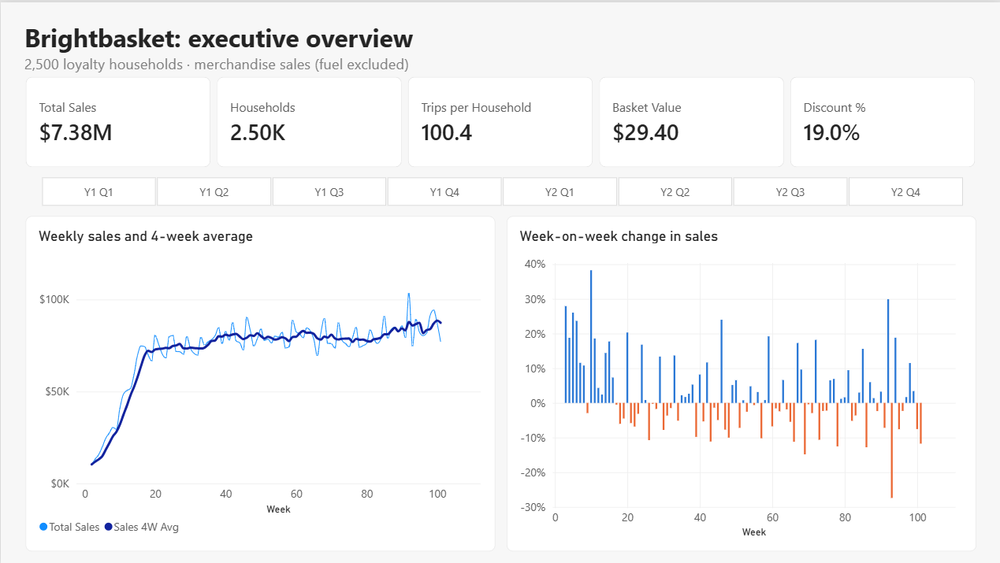
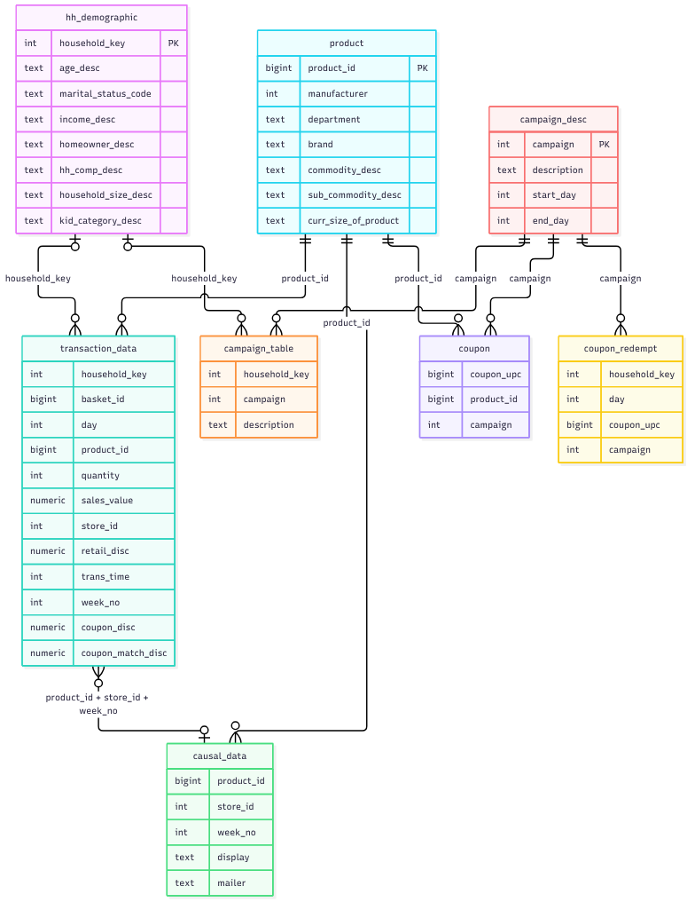
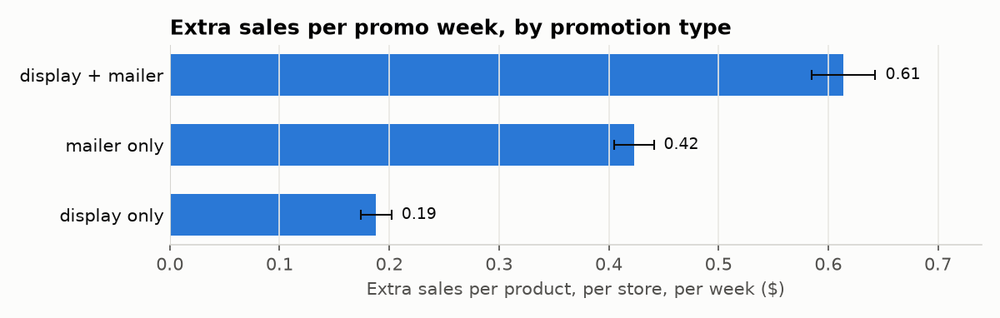
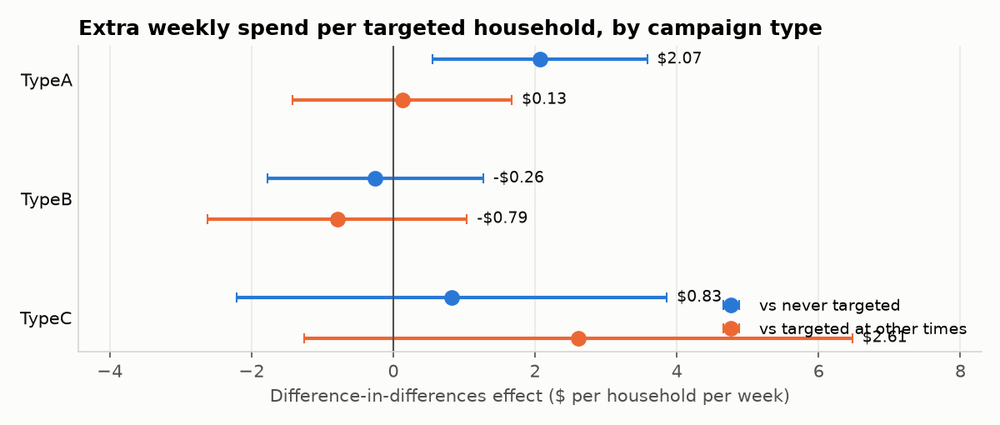
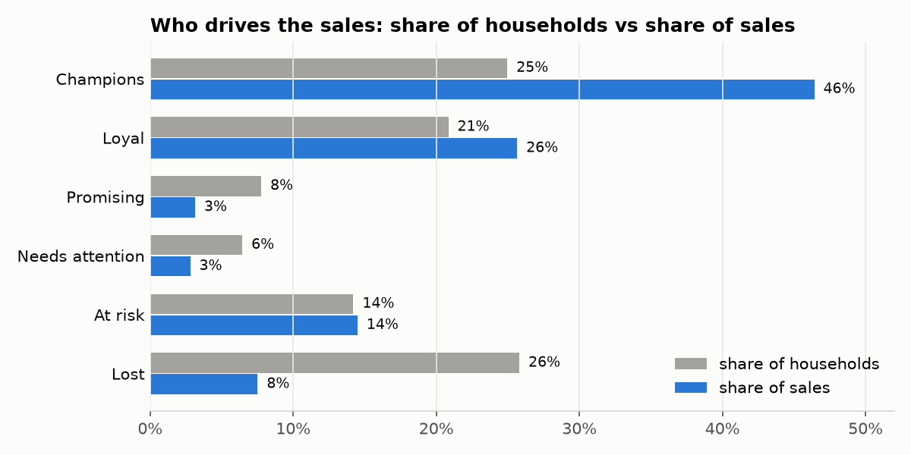
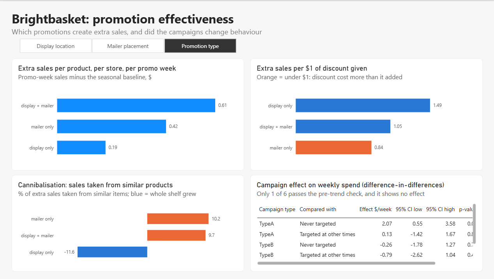
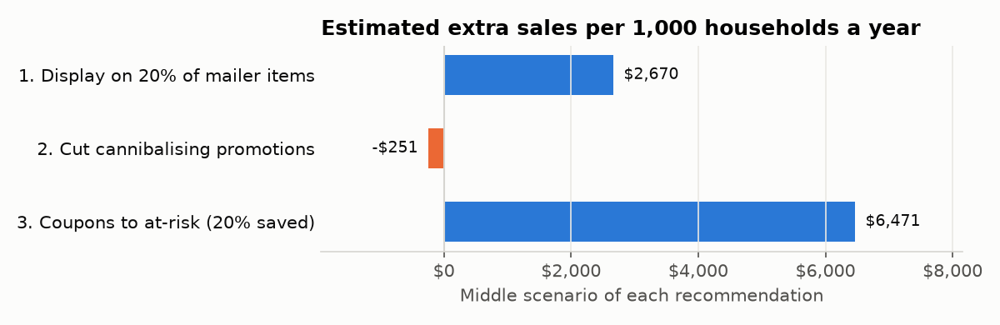

# Which promotions actually pay?

Grocery chains spend a lot on promotions: displays, the weekly mailer, coupons, direct-mail campaigns. I wanted to know which of them bring in sales that wouldn't have happened anyway, and which just give a discount on things people were going to buy regardless.

The chain here, Brightbasket, is made up. The data is real: dunnhumby's *The Complete Journey*, two years of shopping by 2,500 loyalty households (2.6M purchase lines, 36.8M promotion records).

**Tools:** Excel · PostgreSQL · Python (pandas, statsmodels) · Power BI

## Key results

Brightbasket gives back about 18% of its sales as discounts. Here's what that money buys.

| | |
|---|---|
| **$1.49 vs $0.84** | Extra sales for every $1 of discount: in-store displays vs mailer-only promotions |
| **+$2,670 a year** | Extra sales per 1,000 households from giving 20% of mailer items a display too |
| **$80.9K a year** | What 355 at-risk households are likely to take with them if nothing changes |

**What I'd do:** put displays next to more mailer items, stop paying to move features onto the front page, and send coupons to at-risk households instead of the best customers. That last one needs an A/B test first.

**See it:** [Dashboard](dashboard/) · [Stakeholder deck](docs/stakeholder_deck.pdf) · [Sample weekly report](reports/weekly_category_report_week_101.xlsx)



## 1. Ask

Over two years, $1.44M went back to customers as discounts and half of everything they bought had one. On top of that, 30 direct-mail campaigns reached 63% of households. Nobody could say how much of it actually worked.

Playing the analyst reporting to the Head of Marketing, I set out to answer four things:

1. Which displays and mailer slots create extra sales?
2. Did the campaigns change how much people spend?
3. Which customers respond, and who's about to leave?
4. Where should next quarter's promotion money go?

To keep sales easy to explain, I broke them into **households × trips per household × spend per trip**: 2,500 × 100.4 × $29.40 = $7.38M on the cleaned data. The full KPI tree is in [docs/01_kpi_tree.md](docs/01_kpi_tree.md).

## 2. Prepare

Eight CSVs from Kaggle, loaded into PostgreSQL with `src/load_raw.py` (about 40 million rows). The table that makes this project possible is the promotions table. It records, product by product, store by store and week by week, whether something was on display or in the mailer. Joining it to purchases on product, store and week tells me whether an item was promoted when someone bought it.



One gap shaped everything after: promotion records only cover 115 of the 582 stores, and weeks 9–101, so the uplift work uses just those. Row counts, keys and a column guide for every table are in [docs/02_data_notes.md](docs/02_data_notes.md).

### Is the data good enough?

I checked it against **ROCCC**: reliable, original, comprehensive, current and cited.

| | Verdict | Why |
|---|---|---|
| **Reliable** | Mostly yes | Real loyalty-card data from dunnhumby, widely used in retail research. A few quirks to clean (see Process). |
| **Original** | Yes, with a caveat | First-party retailer data released by dunnhumby. I used a Kaggle copy; the row counts match dunnhumby's documented counts. |
| **Comprehensive** | Good for this question | Has transactions, promotions, campaigns, coupons, products and demographics, which is rare. Gaps: demographics for only 32% of households, promotions for only 115 stores, no promotion costs, no real dates. |
| **Current** | No | The shopping is from roughly a decade ago and the exact years aren't disclosed. Fine for learning how promotions work; I wouldn't quote the dollar figures as today's market. |
| **Cited** | Yes | Published by dunnhumby and cited in many studies. Free for non-commercial use under dunnhumby's terms. |

## 3. Process

I ran 14 data-quality checks in SQL (`sql/03_quality_checks.sql`): nulls, duplicates, zero and negative values, outliers, date logic and products with no category. Everything after that reads from a clean layer (`sql/04_clean_views.sql`), so the raw tables stay untouched.

The main decisions:

- **Took out fuel, store-level adjustments and coupons scanned as items.** None of them are groceries, and fuel quantities in gallons would skew every per-item number.
- **Dropped 10,504 lines with zero quantity or zero sales.** Nothing was sold, so they'd only inflate item counts.
- **Removed 5,164 duplicate coupon rows.** They'd have doubled up coupons per campaign.
- **Kept one row for 15,245 product-store-weeks with two different promotion records,** counting it as promoted if either record said so.
- **Set 10 positive store discounts to zero.** A discount can't raise the price, so I treated them as errors.

| | Raw | Clean |
|---|---|---|
| Purchase lines | 2,595,732 | 2,546,112 |
| Sales | $8.06M | $7.38M |
| Shopping trips | 276,484 | 251,063 |

About 25,000 trips disappeared because people had bought only fuel on them. The full cleaning log is in [docs/02_data_notes.md](docs/02_data_notes.md).

## 4. Analyze

### 1. Displays give the most extra sales per discount dollar

For every week a product was promoted, I compared its sales with a normal week for the same product in the same store, adjusted for the time of year. That gap is the **uplift**. To check the method wasn't inventing it, I ran it 20 times on fake promotion weeks and got roughly $0.

| Promotion | Extra sales per product, per store, per week | Share of all extra sales | Extra sales per $1 of discount |
|---|---|---|---|
| Mailer only | $0.42 | 55% | $0.84 |
| Display + mailer | $0.61 | 30% | $1.05 |
| Display only | $0.19 | 15% | $1.49 |



- The mailer drives most of the volume, but mailer-only weeks gave away $192.9K of discount for $161.8K of extra sales.
- Display and mailer simply add up ($0.42 + $0.19 ≈ $0.61). That makes adding a display to a mailer item the cheapest win.
- Front-page features sell three times what interior-page ones do ($0.77 vs $0.26 a week), partly because they're discounted harder.
- Where the display sits in the store barely matters: all nine locations land between $0.17 and $0.21.
- In Floral, Cosmetics, Nutrition and packaged Seafood, 37–55% of the "extra" was taken from similar products (**cannibalisation**).
- No sign of stockpiling: sales the week after a promotion are normal, not lower.

One caveat: this compares discount with sales, not profit, and retailers tend to promote things when demand is already rising.

### 2. I can't show the campaigns changed anything

I used **difference-in-differences**: how much a targeted household's weekly spend changed from before to during a campaign, minus the same change for similar households that weren't targeted. It only works if both groups were moving in step beforehand.

| Campaign | Coupon response | Effect vs never-targeted households | Effect vs households targeted at other times |
|---|---|---|---|
| Type A | 16% | +$2.07 a week | +$0.13 a week |
| Type B | 8% | −$0.26 | −$0.79 |
| Type C | 8% | +$0.83 | +$2.61 |



- Targeted households were already cutting back before the campaigns started. It looks like win-back targeting, so five of the six comparisons aren't fair ones.
- The one fair comparison (Type B vs never targeted) shows no effect.
- Before trusting the method, I ran it on data with a planted +$5 a week effect. It found +$4.89.

So this data can't prove the campaigns worked. Only a randomised test can.

### 3. Coupons mostly go to people who'd shop anyway

I grouped households with **RFM**: how recently they shopped, how often, and how much they spent.

| Segment | Households | Sales |
|---|---|---|
| Champions | 25% | 46% |
| Loyal | 21% | 26% |
| At risk | 14% | 14% |
| Lost | 26% | 8% |
| Promising + Needs attention | 14% | 6% |



- 355 **at-risk** households used to shop as often as Loyal ones but haven't been in for about a month. Over two years they spent $1.07M.
- My churn flag works as an early warning. Tested on an earlier cut of the data, flagged households were 6.7× more likely never to come back (32% vs 4.8%).
- 36% of Champions redeemed a coupon, against 20% of at-risk households. The coupons reward the people least likely to leave.
- Higher-income households redeem more (52% vs 35%), though with this sample I'd call it a lean, not a fact.

## 5. Share

### Dashboard

Four Power BI pages built on views from `sql/08_bi_views.sql`, in Import mode so the file opens without the database running.

| Page | Answers |
|---|---|
| Executive overview | How is the business doing week to week? |
| Category performance | Which categories drive sales, and which are growing? |
| Promotion effectiveness | Which promotions pay, and did the campaigns work? |
| Customer segments | Who should we keep, and who should we win back? |



More screenshots: [categories](dashboard/screenshots/page2_categories.png) · [customer segments](dashboard/screenshots/page4_segments.png).

### Stakeholder deck

[docs/stakeholder_deck.pdf](docs/stakeholder_deck.pdf) is the 7-slide presentation I'd give the Head of Marketing. It starts with the business question and ends with four moves for next quarter.

| # | Slide | What it says |
|---|---|---|
| 1 | Title | Where Brightbasket's promotion money actually works |
| 2 | The business question | We spend heavily on promotions but can't yet say which ones pay off |
| 3 | Where sales come from | $7.38M = 2,500 households × 100 trips × $29.40, and 19% goes back as discount |
| 4 | What promotions really do | Mailers bring the volume, displays bring the cheapest extra sales |
| 5 | Campaign impact | We can't show the campaigns changed spending, so the next step is a proper test |
| 6 | Customer segments | 355 at-risk households worth $1.07M are the best place for coupons |
| 7 | Recommendation | Four moves for next quarter |

## 6. Act

### What I recommend

| # | Move | Extra sales per 1,000 households a year | What it costs | How sure I am |
|---|---|---|---|---|
| 1 | Put a display next to 20% of mailer-only items | +$2,670 | $1,219 more discount; about 21% more display space | Fairly sure |
| 2 | Stop upgrading interior-page features to the front page | Saves $0.27 on every extra discount dollar | Nothing | Fairly sure |
| 3 | Move coupons from Champions to at-risk households | +$6,471 if it keeps 1 in 5 of those leaving | Nothing, same coupons | Not until tested |
| 4 | Test move 3 before rolling it out | Decides move 3 | About 6,700 households for 12 weeks | A test settles it |



Numbers are scaled to 1,000 households a year so they can be multiplied up to the whole chain. Move 3 breaks even if it keeps just 1% of at-risk spending.

### Testing it first

Campaign targeting wasn't random, which is why I couldn't measure it. A test fixes that by letting a coin decide who gets the offer:

- **Who:** at-risk and churn-flagged households, split 50/50 at random
- **Measure:** average weekly spend over 8 weeks, counting $0 for weeks with no visit
- **Size:** about 3,350 per group to catch a 10% lift with 95% confidence and 80% power
- **Length:** 8 weeks of offer plus 4 weeks after, to catch any dip
- **Go ahead only if** the whole confidence range sits above break-even

This sample only has 701 such households, so the test would run across the chain's full loyalty base.

### Automation

`python src/run_pipeline.py` rebuilds everything in PostgreSQL (about 12 minutes) and writes an Excel report for the latest week: headline numbers, every department and category against last week, the 4-week average and last year, plus the biggest risers and fallers. Add `--report-only` to skip the rebuild, or `--week 95` for a different week. In the [sample for week 101](reports/weekly_category_report_week_101.xlsx), sales fell 11.7% to $76.9K, led by beef, soft drinks and frozen pizza.

## Running it yourself

1. Download the 8 CSVs from [Kaggle](https://www.kaggle.com/datasets/frtgnn/dunnhumby-the-complete-journey) into `data/raw/` (they're too big for GitHub).
2. `pip install -r requirements.txt`
3. Create a PostgreSQL database called `retail_promo`, then run `python src/load_raw.py` to load the CSVs.
4. Run `sql/03` to `sql/07` in order, then `notebooks/02_campaign_impact.ipynb`, then `sql/08`. The order matters because 08 reads the campaign results that notebook saves.
5. Open the notebooks for the charts and tests, or the `.pbix` for the dashboard.
6. After that, `python src/run_pipeline.py` redoes step 4 and writes the weekly report in one go.

```
retail-promo-analytics/
├── data/raw/      the Kaggle CSVs (not in GitHub)
├── sql/           01–08: load, profile, quality checks, clean, uplift, cannibalisation, RFM, dashboard views
├── src/           load_raw.py, run_pipeline.py
├── notebooks/     00 first look · 01 uplift · 02 campaigns · 03 segments · 04 recommendations
├── dashboard/     the .pbix file and screenshots
├── docs/          KPI tree, data notes, charts, stakeholder deck
└── reports/       a sample weekly report
```
