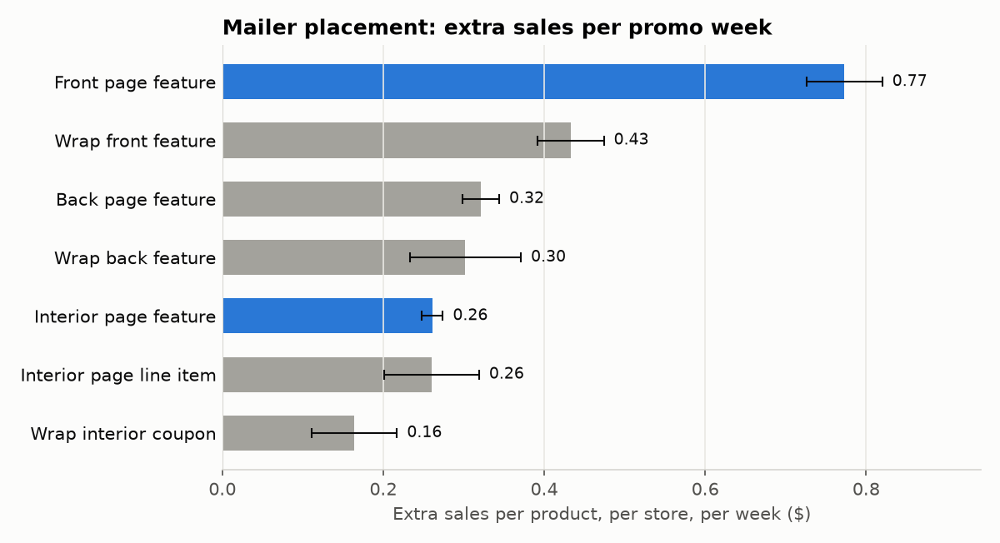
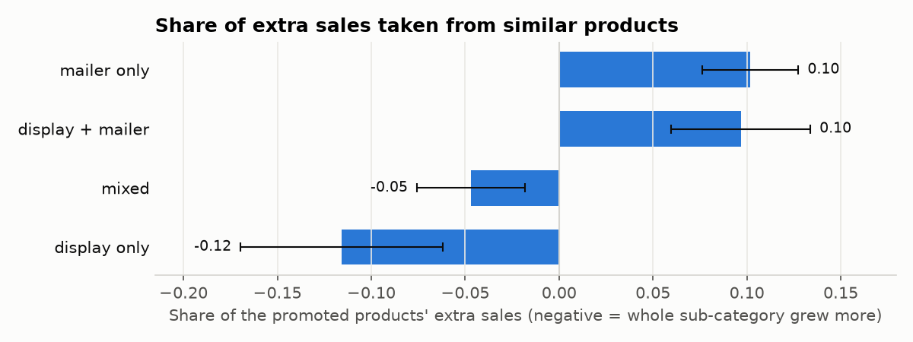
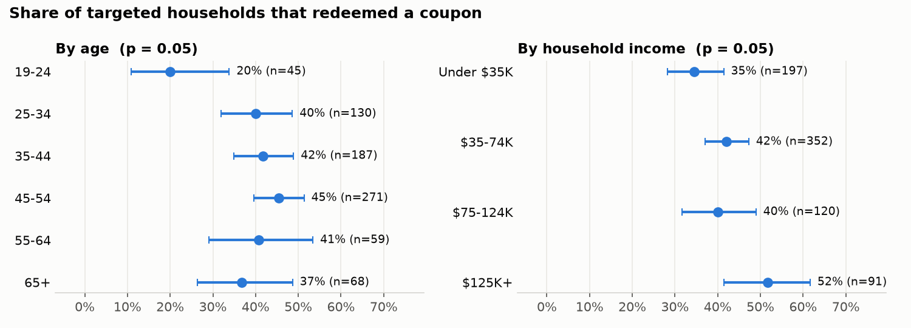
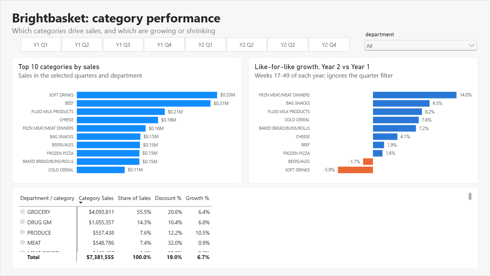
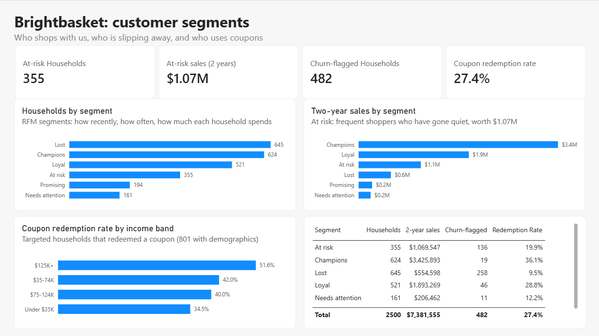

# Which promotions actually pay?

Brightbasket, a grocery chain, gives back about 18% of its sales as discounts. I worked out which of its promotions bring in extra sales and which just make things cheaper that people were going to buy anyway, then recommended where next quarter's budget should go.

Brightbasket is fictional. The data is real: *The Complete Journey* by dunnhumby, two years of shopping by 2,500 loyalty households (2.6M purchase lines, 36.8M promotion records).

**Tools:** Excel · PostgreSQL · Python (pandas, statsmodels) · Power BI

## The answer in 30 seconds

**The question:** which displays, mailer slots and campaigns create sales that wouldn't have happened anyway, and where should the Head of Marketing move next quarter's money?

| Number | What it means |
|---|---|
| **$1.49 vs $0.84** | Extra sales per $1 of discount: in-store displays vs mailer-only promotions |
| **$2.19** | Extra sales per extra discount dollar when a mailer item also gets a display: about +$2,670 a year per 1,000 households |
| **$80.9K a year** | Sales I expect 355 at-risk households to take with them. No campaign could be shown to change spending, so the fix needs a test first |

**My recommendation:** give more mailer items a display, stop paying to upgrade interior-page slots to the front page, and move coupons from Champions (who'd shop anyway) to at-risk households, but only once an A/B test of about 6,700 households confirms the offer works.

**See it:** [Dashboard](dashboard/) · [Slide deck](docs/stakeholder_deck.pdf) · [Memo to the Head of Marketing](docs/marketing_memo.pdf) · [Sample weekly report](reports/weekly_category_report_week_101.xlsx)


---

## 1. Ask

### The situation

Over two years, Brightbasket's 2,500 loyalty households made about 276,000 trips across 582 stores and spent **$8.06M**.

A big share of that came with a discount attached:

- **$1.44M went back to customers as discounts**, which is 17.9% of sales. Almost all of it was the store's own price cuts; coupons were only about $43K.
- **Half of everything people bought** had some discount on it.
- **30 direct-mail campaigns** (5 Type A, 19 Type B, 6 Type C) reached 1,584 households, 63% of the base.
- Products were also pushed through **in-store displays and the weekly mailer**, recorded product by product, store by store, week by week.

What nobody can say right now is how much of this actually brought in extra sales, and how much just gave customers a lower price on things they were going to buy anyway.

### Business task

> Brightbasket gives back about 18% of its sales as discounts, and half of everything customers buy carries one, but nobody knows how much of that money actually brings in extra sales. This project works out which promotions (in-store displays, mailer placements and direct-mail campaigns) create sales that wouldn't have happened otherwise, which households respond to them, and how the Head of Marketing should shift next quarter's promotion budget, with the expected extra sales in dollars.

### Who it's for

| Stakeholder | What they decide | The question they'd ask me | What I give them |
|---|---|---|---|
| **Head of Marketing** (decision owner) | How next quarter's promotion budget is split | "Where should the money go, and what will I get for it?" | Extra sales by promotion type, the customer segments worth targeting, and a recommended budget shift with the expected gain in dollars |

### Questions I'm answering

| # | Question | How |
|---|---|---|
| Q1 | How do sales, households, trips and spend per trip move over the two years? | KPI tree and weekly trends in SQL |
| Q2 | Which display and mailer placements create **extra** sales? | Each product's promotion weeks compared with its normal weeks (its baseline) |
| Q3 | Do some promotions just pull sales forward, or take sales from similar products? | Sales dip after the promotion; drops in similar products during it |
| Q4 | Did campaign types A, B and C change how much households spend, and is the change real or noise? | Difference-in-differences with a significance test |
| Q5 | Which customers respond, and who's at risk of leaving? | RFM segments, churn flags, coupon redemption by demographic group |
| Q6 | Where should next quarter's budget move, and what's it worth? | Combines Q2–Q5, plus an A/B test design to confirm the top pick |

### How I'll measure it

Sales break down as **households (2,500) × trips per household (110.6) × spend per trip ($29.14) = $8.06M**, so any change in sales can be traced to more customers, more visits or bigger baskets.

For promotions, the number that matters is **net extra sales**: sales above a product's normal week, minus the dip afterwards, minus sales taken from similar products. I also look at it per $1 of discount.

The full KPI tree, every formula, and a plain-English glossary are in **[docs/01_kpi_tree.md](docs/01_kpi_tree.md)**.

---

## 2. Prepare

The 8 Kaggle CSVs are loaded into a local **PostgreSQL** database with `src/load_raw.py`, which creates the tables from `sql/01_create_raw_tables.sql` and bulk-loads about 40 million rows. `sql/02_profile_raw.sql` then checks row counts, unique keys, date coverage and joins.

### The tables

| Table | One row = | Unique key | Rows | Covers |
|---|---|---|---|---|
| `transaction_data` | one product bought on one shopping trip | `basket_id` + `product_id` | 2,595,732 | days 1–711, weeks 1–102, 582 stores, 2,500 households |
| `causal_data` | one product in one store in one week, with its display and mailer placement | `product_id` + `store_id` + `week_no` *(15,245 repeats)* | 36,786,524 | weeks 9–101, **115 stores** |
| `product` | one product | `product_id` | 92,353 | |
| `hh_demographic` | one household | `household_key` | 801 | 801 of 2,500 households |
| `campaign_desc` | one campaign | `campaign` | 30 | day 224 to day 719 |
| `campaign_table` | one household targeted by one campaign | `household_key` + `campaign` | 7,208 | 1,584 households |
| `coupon` | one product covered by one coupon in one campaign | none *(5,164 exact repeats)* | 124,548 | |
| `coupon_redempt` | one coupon redeemed by one household on one day | | 2,318 | |

### How they join


The join that matters most is **transactions to promotions on `product_id` + `store_id` + `week_no`**. That's how I know whether a product was on display or in the mailer in the week someone bought it.

Every purchase matches a product, and every redeemed coupon matches a coupon in the coupon table, so nothing gets lost when joining.

<details>
<summary><b>Column guide</b> (click to open)</summary>

**transaction_data**

| Column | Meaning |
|---|---|
| `household_key` | Household ID |
| `basket_id` | Shopping trip ID. One basket = one trip |
| `day` | Day number, 1–711. There are no real dates |
| `product_id` | Product ID, joins to `product` |
| `quantity` | Units bought |
| `sales_value` | Dollars the store received for this line, after discounts |
| `store_id` | Store ID |
| `retail_disc` | Loyalty-card discount from the store, stored as a negative number |
| `trans_time` | Time of day as HHMM, e.g. 1631 = 4:31 pm |
| `week_no` | Week number, 1–102 |
| `coupon_disc` | Manufacturer coupon discount (negative) |
| `coupon_match_disc` | Extra discount when the store matches a manufacturer coupon (negative) |

**causal_data (promotions)**

| Column | Meaning |
|---|---|
| `product_id`, `store_id`, `week_no` | Which product, where, and when |
| `display` | Where it was displayed in store. `0` = not on display. Other codes per dunnhumby's guide: 1 store front, 2 store rear, 3 front end cap, 4 mid-aisle end cap, 5 rear end cap, 6 side-aisle end cap, 7 in-aisle, 9 secondary location, A in-shelf |
| `mailer` | Where it appeared in the weekly mailer. `0` = not in the mailer. A interior page feature, C interior page line item, D front page feature, F back page feature, H wrap front feature, J wrap interior coupon, L wrap back feature, P interior page coupon, X free on interior page, Z free on front/back page or wrap |

**product**

| Column | Meaning |
|---|---|
| `product_id` | Product ID |
| `manufacturer` | Manufacturer code |
| `department` | Broad area, e.g. GROCERY, PRODUCE, DRUG GM |
| `brand` | National (a big brand) or Private (store brand) |
| `commodity_desc` | Category, e.g. SOFT DRINKS |
| `sub_commodity_desc` | Subcategory. Used to find "similar products" when checking cannibalisation |
| `curr_size_of_product` | Pack size as text, e.g. 12 OZ |

**hh_demographic**

| Column | Meaning |
|---|---|
| `household_key` | Household ID |
| `age_desc` | Age band of the head of household, e.g. 25-34 |
| `marital_status_code` | A = married, B = single, U = unknown |
| `income_desc` | Income band, e.g. 50-74K |
| `homeowner_desc` | Homeowner, renter, unknown |
| `hh_comp_desc` | Household make-up, e.g. 2 Adults Kids |
| `household_size_desc` | Number of people, 1 to 5+ |
| `kid_category_desc` | Number of children, 1 to 3+, or None/Unknown |

**Campaigns and coupons**

| Table.column | Meaning |
|---|---|
| `campaign_desc.description` | Campaign type: TypeA, TypeB or TypeC |
| `campaign_desc.start_day`, `end_day` | When the campaign ran, as day numbers |
| `campaign_table.household_key`, `campaign` | Which households were sent which campaign |
| `coupon.coupon_upc` | Coupon ID. One coupon can cover many products |
| `coupon.product_id` | A product the coupon can be used on |
| `coupon_redempt.day` | Day the household used the coupon |

</details>

### What the profiling turned up

1. **Promotion data only covers 115 of the 582 stores.** The uplift analysis is limited to those stores. Otherwise products elsewhere would look "never promoted" just because nobody tracked them.
2. **Promotion data only covers weeks 9–101.** Weeks 1–8 and 102 are left out of the uplift analysis.
3. **Campaigns run from day 224 to day 719.** The first one starts about 32 weeks in, which leaves a good "before" period for the campaign analysis. The last one ends after the data stops (day 711), so its "during" period is cut short.
4. **One row per basket and product is unique.** Buying 3 of the same item is one row with quantity 3, not three rows.
5. **To clean in Process:** 15,245 repeated product–store–week rows in the promotions table, 5,164 exact repeats in the coupon table, and some positive values in `retail_disc`, a column that should only be negative.

### Is the data good enough? (ROCCC)

| | Verdict | Why |
|---|---|---|
| **Reliable** | Mostly yes | Real loyalty-card data from dunnhumby, widely used in retail research. A few quirks to clean (above). |
| **Original** | Yes, with a caveat | First-party retailer data released by dunnhumby. I used a Kaggle copy; the row counts match dunnhumby's documented counts. |
| **Comprehensive** | Good for this question | Has transactions, promotions, campaigns, coupons, products and demographics, which is rare. Gaps: demographics for only 32% of households, promotions for only 115 stores, no promotion costs, no real dates. |
| **Current** | No | The shopping is from roughly a decade ago and the exact years aren't disclosed. Fine for learning how promotions work; I wouldn't quote the dollar figures as today's market. |
| **Cited** | Yes | Published by dunnhumby and cited in many studies. Free for non-commercial use under dunnhumby's terms. |

---
 
## 3. Process
 
I ran 14 data-quality checks in SQL (`sql/03_quality_checks.sql`): nulls, duplicates, zero and negative values, outliers, day/week logic and products with no category. Then I built a **clean layer** (`sql/04_clean_views.sql`) that everything after this point reads from. The raw tables stay untouched.
 
### Cleaning log
 
| # | What I found | What I did | Why | Rows affected |
|---|---|---|---|---|
| 1 | No nulls in any key column | Nothing | | 0 |
| 2 | **Fuel (KIOSK-GAS)**: $544K of sales, quantities up to 89,638 (gallons) | Excluded | Grocery promotions don't apply to fuel, and gallons would distort every per-item number | 22,059 |
| 3 | **MISC SALES TRAN**: store-level transactions, quantities up to 85,055 | Excluded | Not products | 6,050 |
| 4 | **490 products with "NO COMMODITY DESCRIPTION"** (MISC. TRANS.) | Excluded | No category, so they can't be used in category or cannibalisation analysis | 2,351 |
| 5 | **15 products with a blank department**, all at $0 | Excluded | Placeholder or voided lines | 7,839 |
| 6 | **COUP/STR & MFG**: coupons scanned as items | Excluded | Not products | 817 |
| 7 | Lines with **quantity 0 or $0 sales** in the remaining departments | Dropped | Nothing sold or nothing paid; they'd inflate item counts | 10,504 |
| 8 | **10 rows with a positive `retail_disc`** | Kept the sale, set that discount to 0 | A discount can't raise the price, so I treat it as an error | 10 |
| 9 | Discounts stored as **negative numbers** | Turned them into positive dollar amounts | Easier to add up and read | all |
| 10 | **5,164 exact duplicate rows** in `coupon` | Removed the copies | Would inflate coupons per campaign | 5,164 |
| 11 | **15,245 product–store–weeks with two different placements** in `causal_data`, none of them exact copies | Kept one row each; if either record shows a display or mailer, I count it as promoted | 0.04% of the table, and "promoted in either record" is the safer reading | 15,245 |
| 12 | Every week spans 7 days, all times are valid, every redemption falls inside its campaign | Nothing | | 0 |
 
After removing fuel and the other non-products, the largest quantity left is 144 (produce sold by count), so I didn't need an outlier rule.
 
### What cleaning changed
 
| | Raw | Clean | Removed |
|---|---|---|---|
| Purchase lines | 2,595,732 | 2,546,112 | 49,620 (1.9%) |
| Sales | $8,057,463 | **$7,381,555** | $675,908 (8.4%) |
| Shopping trips | 276,484 | 251,063 | 25,421 (9.2%) |
| Households | 2,500 | 2,500 | 0 |
 
The one surprise was the **25,421 trips that disappeared**. Those were visits where someone bought only fuel or other non-product items, so once those lines went, the whole trip went with them.
 
I use **$8.06M** when talking about total store sales and **$7.38M** for everything in the analysis. On the clean data, the sales tree becomes: **2,500 households × 100.4 trips × $29.40 per trip = $7.38M**.
 
### The clean layer
 
| Object | One row = | Used for |
|---|---|---|
| `clean.transactions` | one product on one trip (merchandise only) | the base for everything else |
| `clean.promotions` | one product in one store in one week, with display and mailer flags | promotion flags |
| `clean.weekly_product_store_sales` | one product in one store in one week, with sales, units, discount and promo flags | the uplift analysis |
| `clean.weekly_category_sales` | one category in one week | category trends |
| `clean.baskets` | one shopping trip: value, items, lines, discount | trips and basket value |
| `clean.households` | one household: trips, sales, campaigns received, coupons redeemed, demographics | campaign impact and customer segments |
| `clean.coupons`, `clean.campaigns` | de-duplicated coupons; campaigns with length and households reached | campaign analysis |
 
### Keeping queries fast
 
With a 36-million-row table, a careless query can take minutes. What I did about it:
 
- **Indexes** on the columns I join on (`product_id`, `store_id`, `week_no`, `basket_id`), so PostgreSQL can jump straight to matching rows instead of scanning the whole table.
- **Materialized views** for anything built on the big tables. The heavy work happens once when I build them, not every time I query.
- **Only the columns I need**, never `SELECT *`, and filters as early as possible.
- **`EXPLAIN ANALYZE`** in front of a slow query to see whether it's using an index or scanning everything.

---

## 4. Analyze
 
### Part 1: Which promotions create extra sales?
 
**How I measured it.** For every week a product was on display or in the mailer, I compared its sales with a normal week for the same product in the same store (its **baseline**). I limited this to the 115 stores and weeks 9–101 that have promotion data. Each week is adjusted for how busy that department usually is in that week, and the baseline counts weeks where the product sold nothing. I split the weeks into display only, mailer only, and both, so no week is counted twice. Every number comes with a 95% range built from product–store totals. SQL: `sql/05_uplift.sql`, `sql/06_cannibalisation.sql`. Notebook: `notebooks/01_promo_uplift.ipynb`.
 
The dollar amounts are from the 2,500 loyalty households, not whole-store sales, so they look small. What matters is how the promotion types compare.
 
| Promotion type | Extra sales per promo week | Share of all extra sales | Extra sales per $1 of discount |
|---|---|---|---|
| Mailer only | $0.42 ± 0.02 | 55% | $0.84 |
| Display + mailer | $0.61 ± 0.03 | 30% | $1.05 |
| Display only | $0.19 ± 0.01 | 15% | $1.49 |
 

 

 

 
**What I found**
 
1. **The mailer drives most of the extra sales.** Mailer-only promotions created 55% of all extra sales ($161.8K of $292.0K).
2. **Display and mailer simply add up.** Display + mailer lifts a product by $0.61 per store per week, almost exactly mailer ($0.42) + display ($0.19). There's no bonus for combining them.
3. **Where the display sits doesn't matter.** All nine display locations land between $0.17 and $0.21 per week, and their ranges overlap.
4. **The front page is worth 3× the interior page.** Front-page features add $0.77 per week vs $0.26 for interior-page features, yet interior pages take half of all mailer-only weeks.
5. **Displays are the cheapest extra sales.** Display-only promotions return $1.49 of extra sales per $1 of discount. Mailer-only promotions return $0.84: they gave away $192.9K in discounts for $161.8K of extra sales.
6. **Mailers take some sales from similar products; displays grow the whole shelf.** Mailer-only promotions took 10% (±2.6%) of their extra sales from similar products, while display-only promotions lifted the whole sub-category 12% more than the promoted item.
7. **In a few departments, promotions mostly shift sales around.** In Floral (55%), Cosmetics (43%), Nutrition (40%) and packaged Seafood (37%), much of the "extra" was taken from similar items.
8. **No sign of stockpiling.** Sales the week after a promotion ends are slightly above normal, not below.
**How I know the method isn't making things up.** I ran a placebo test: I labelled random normal weeks as fake promo weeks and ran the same calculation 20 times. The fake uplift came out at −$0.0002 per week, and the range included zero in 19 of 20 runs. The real display uplift ($0.19) is about 37 times bigger than that whole range.
 
**What I'm careful about**
 
- "Free item" mailer placements (X, Z, P) are left out. A free item has $0 sales, so dollars are the wrong way to measure it.
- "Extra sales per $1 of discount" counts all discount given in promo weeks, including discount that would have happened anyway. It also compares discount with sales, not profit.
- Retailers tend to promote products when demand is already rising, so some of the uplift may be timing rather than the promotion itself. A proper A/B test is the way to settle that (Part 6).
- The cannibalisation check covers 74% of promoted sales. Sub-categories promoted almost every week have no normal weeks to compare against.

### Part 2: Did the campaigns change how much households spend?
 
**How I measured it.** 30 direct-mail campaigns (5 Type A, 19 Type B, 6 Type C) went to 1,584 households. I used **difference-in-differences**: for each campaign, the change in a targeted household's weekly spend from the 8 weeks before to the weeks during, minus the same change for comparison households. I only compared households with others who had a similar spending history, measured on an earlier stretch of time so it doesn't overlap the "before" window. Standard errors are clustered by household. Notebook: `notebooks/02_campaign_impact.ipynb`.
 
The key assumption is that without the campaign, both groups' spending would have moved in parallel. I checked it on the 16 weeks before each campaign (the **pre-trend check**). I tried two comparison groups:
- **never targeted**: the 916 households that never got any campaign
- **targeted at other times**: households the retailer did target, but with nothing running for them around this campaign
| Campaign type | Response rate | Effect vs never targeted | Effect vs targeted at other times | Pre-trend check |
|---|---|---|---|---|
| A | **16%** | **+$2.07/week** (p = 0.008) | +$0.13/week (p = 0.87) | fails in both |
| B | 8% | −$0.26 (p = 0.74) | −$0.79 (p = 0.40) | fails vs other times |
| C | 8% | +$0.83 (p = 0.59) | +$2.61 (p = 0.19) | fails in both |
 

 
**What I found**
 
1. **Type A campaigns reach the most households and get double the response.** An average of 796 households per campaign, and 16% of them redeemed a coupon, against 8% for Types B and C.
2. **The retailer targets its heavy shoppers.** Targeted households spent $50–90 a week before a campaign; households that never got one spent $11–17.
3. **It targets them just as their spending starts to slip.** In the 8 weeks before a campaign, targeted households' spending fell by $1.7–5.3 a week more than either comparison group's. It looks like win-back targeting.
4. **Type A's effect is somewhere between $0 and $2 per household per week.** It's +$2.07 (+4% of spend) against never-targeted households, but only +$0.13 against the fairer comparison.
5. **Types B and C show no measurable effect** in either comparison.
6. **Bottom line: this data can't prove the campaigns changed spending.** Targeting wasn't random, so I can't separate the campaign's effect from households bouncing back to their normal level. The only way to know is a randomised holdout, which is the A/B test I design in Act.
**How I checked the method.** Before running it on the real data, I tested the notebook on data with a planted +$5/week effect for Type A and none for B or C. It recovered +$4.89 for A and found nothing for B and C. My first version had matched households on the same "before" window used in the comparison. On the planted data it reported effects for every type and failed its own pre-trend check, a textbook case of regression to the mean. Matching on an earlier, separate stretch of history fixed it.
 
### Part 3: Who are the customers, who is slipping away, and who responds to coupons?
 
**How I did it.** In SQL (`sql/07_rfm.sql`), I scored every household 1–5 on **R**ecency (days since last trip), **F**requency (trips) and **M**onetary value (spend) using `NTILE`, and grouped them into six segments. I also flagged churn risk with thresholds set from each household's own habits: **gone quiet** means no trip for more than twice its usual longest gap between trips (found with `LAG` and `PERCENTILE_CONT`), and **fading** means spending in the last 13 weeks halved. Notebook: `notebooks/03_customer_segments.ipynb`.
 
| Segment | Who they are | Households | Sales |
|---|---|---|---|
| Champions | shop often, shopped recently | 25% | **46%** |
| Loyal | regulars | 21% | 26% |
| Promising | recent, not frequent yet | 8% | 3% |
| Needs attention | occasional, cooling off | 6% | 3% |
| **At risk** | used to shop often, not lately | **14%** | **14%** |
| Lost | rarely, and not recently | 26% | 8% |
 

 
**Testing the churn flag.** I rewound to day 620, flagged households using only data up to then, and checked who shopped again in the last 13 weeks.
 
| | Households | Never came back |
|---|---|---|
| Flagged at day 620 | 201 | **32%** |
| Not flagged | 2,297 | 4.8% |
 
**Who redeems coupons.** Among the 1,584 households that received a campaign, 27% redeemed at least one coupon. Each group gets a 95% range, and a chi-square test checks whether the groups really differ.
 

 
**What I found**
 
1. **A quarter of households drive almost half the sales.** Champions are 25% of households and 46% of sales. With Loyal customers, it's 46% of households and 72% of sales.
2. **"At risk" is the group to win back.** 355 households (14%) used to shop about as often as Loyal customers (106 trips) but haven't been in for 33 days on average. They're worth $1.07M in lifetime sales.
3. **One in five households shows a churn warning sign.** 482 households (19%) have gone quiet or are fading. Before slipping, they spent $117K a quarter, about 12% of a quarter's sales.
4. **My churn flag works as an early warning.** Flagged households were 6.7× more likely never to come back (32% vs 4.8%). Two-thirds of them did return, so the flag marks the moment to step in, not a lost customer.
5. **Retention is steady.** About 95% of households active in one quarter shop again the next.
6. **Coupons mostly go to customers who'd shop anyway.** 36% of targeted Champions redeemed a coupon, against 20% of At risk and 9.5% of Lost households (p < 0.001).
7. **Higher-income households redeem more; the youngest redeem least.** 52% of $125K+ households redeemed vs 35% under $35K (p = 0.048), and 20% of 19–24 year-olds vs about 40–45% for other ages (p = 0.052). With five demographic tests, I treat these as leaning, not proven.
8. **Owners and renters redeem alike; unknown profiles don't.** Homeowners 46%, renters 49%, but only 29% of households with unknown homeowner status (p < 0.001), likely those less engaged with the loyalty programme.
9. **Put together with Part 2:** campaigns showed no measurable spending lift, and their coupons mostly reward the best, richest customers. The obvious test is to redirect coupons towards At risk households.

---

## 5. Share

### The dashboard

A 4-page Power BI report, `dashboard/retail_promo_dashboard.pbix`. It loads the views in `sql/08_bi_views.sql` in Import mode, so it opens without the database running. Every number comes from DAX measures kept in one `_Measures` table.

| Page | The question it answers | What's on it |
|---|---|---|
| Executive overview | How is the business doing? | Sales, households, trips per household, basket value and discount %; weekly sales with a 4-week average; week-on-week change; quarter filter |
| Category performance | Which categories drive sales, and which are growing? | Top 10 categories, like-for-like growth (weeks 17–49 of each year), a department table that opens into categories |
| Promotion effectiveness | Which promotions pay? | Extra sales per promo week, extra sales per $1 of discount, cannibalisation, campaign results; switch between promotion type, display location and mailer placement |
| Customer segments | Who should we keep, and who should we win back? | At-risk households and sales, churn flags, segments by households and sales, coupon redemption by income |






Three measures that do the heavy lifting:

```dax
-- last week's sales, but only if last week was a full week (the first and last weeks are partial)
Sales Previous Week =
VAR CurrentWeek = MAX ( dim_week[week_no] )
RETURN CALCULATE ( [Total Sales],
    FILTER ( ALL ( dim_week ), dim_week[week_no] = CurrentWeek - 1 && dim_week[complete_week] = TRUE () ) )

Sales WoW % = DIVIDE ( [Total Sales] - [Sales Previous Week], [Sales Previous Week] )

-- like-for-like growth: the same weeks of each year, so households joining in year 1 don't flatter it
Growth % = DIVIDE ( [Sales Y2 LFL] - [Sales Y1 LFL], [Sales Y1 LFL] )
```

### The story

[`docs/stakeholder_deck.pdf`](docs/stakeholder_deck.pdf): 7 slides for the Head of Marketing, from the question to the four moves, with speaker notes.

---

## 6. Act

### What I recommend

| # | Move | Extra sales per 1,000 households a year | Cost | How sure I am |
|---|---|---|---|---|
| 1 | Put a display next to 20% of mailer-only items | +$2,670 | +$1,219 discount; about 21% more display space | Fairly: built on measured uplift |
| 2 | Stop upgrading interior-page features to the front page | Avoids losing $0.27 on every extra discount dollar | None | Fairly |
| 3 | Move Champions' coupons to at-risk households | +$6,471 if the offer keeps 20% of leavers | None: the same coupons, redirected | Low until tested |
| 4 | Test move 3 before rolling it out | Decides whether move 3 happens | About 6,700 households for 12 weeks | A randomised test settles it |

The dollars come from 2,500 loyalty households over two years. I show them per 1,000 households a year so they can be scaled to the whole chain. Notebook: `notebooks/04_recommendations.ipynb`. Memo: [`docs/marketing_memo.pdf`](docs/marketing_memo.pdf).


**What I found**

1. **Giving mailer items a display is the best move.** Doing it for 20% of mailer-only weeks adds about $13.4K of sales over two years for $6.1K more discount: $2.19 per extra discount dollar. The limit is display space, about 21% more.
2. **The front page isn't worth chasing.** Upgrading an interior-page feature adds $0.51 a week in sales but $0.70 in discount, so it returns $0.73 per extra discount dollar. The front page mostly sells more because it's discounted harder.
3. **Cutting promotions where they only shift sales around is a small win.** In Cosmetics, Floral, Nutrition and packaged Seafood it saves $1,612 of discount for $1,255 of real extra sales over two years. Worth doing, too small to lead with.
4. **Coupons for at-risk households have the biggest upside and the least proof.** If an offer keeps 20% of the $80.9K a year that's walking out, it's worth $16.2K a year, for about $854 of coupons now going to Champions. It breaks even at 1%.

### The test before the roll-out

My difference-in-differences couldn't measure the campaigns, because the households that got them were already changing before the campaigns started: Brightbasket chose who to target. A randomised test fixes that, because a coin decides who gets the offer.

| Part | Design |
|---|---|
| Hypothesis | A coupon offer raises at-risk households' weekly spend over 8 weeks, compared with no offer |
| Who | At-risk or churn-flagged households, split 50/50 at random within each segment |
| Primary metric | Average weekly spend per household over 8 weeks, counting $0 for weeks with no trip |
| Sample size | About 3,350 per group to detect a 10% lift ($1.33 a week) with 95% confidence and 80% power (spend averages $13.29 a week, standard deviation $19.41) |
| Duration | 8 weeks of offer, plus 4 weeks after to catch any dip |
| Decision | Roll out only if the whole 95% range sits above break-even; a lift that's real but too small to pay for itself isn't enough |

This data only has 701 such households, so the test has to run across the chain's whole loyalty base.

### Automation

One command rebuilds everything in PostgreSQL and writes a weekly category report to Excel:

```
python src/run_pipeline.py                 # full rebuild (about 12 minutes), then the report
python src/run_pipeline.py --report-only   # just the report
python src/run_pipeline.py --week 95       # the report for any week
```

The report (`reports/weekly_category_report_week_<N>.xlsx`) has a summary of sales, households, trips and basket value against the week before, then department and category tables against last week, the 4-week average and the same week last year, and the 10 biggest risers and fallers. Rises show in blue, falls in orange. In the sample for week 101, sales fell 11.7% to $76.9K, led by beef, soft drinks and frozen pizza.

---
 
## How I ran it
 
1. **Set up the project.** Created this repo, cloned it into VS Code, and made a Python virtual environment (`.venv`) so the project's packages stay separate. `requirements.txt` lists the exact versions I used.
2. **Got the data.** Downloaded the 8 CSVs from [Kaggle (dunnhumby – The Complete Journey)](https://www.kaggle.com/datasets/frtgnn/dunnhumby-the-complete-journey) into `data/raw/`. They're kept out of GitHub with `.gitignore`, because the promotions file alone is about 700 MB.
3. **Took a first look in Python.** `notebooks/00_quick_look.ipynb` reads the CSVs with pandas and pulls the headline numbers used in the Ask section: sales, trips, discounts and campaign reach.
4. **Built the database.** Installed PostgreSQL and created a database called `retail_promo` in pgAdmin. `sql/01_create_raw_tables.sql` sets up the 8 empty tables.
5. **Loaded the data.** Ran `python src/load_raw.py` from the VS Code terminal. It creates the tables and bulk-loads each CSV with PostgreSQL's `COPY` command, about 40 million rows in a few minutes.
6. **Profiled it in SQL.** Ran `sql/02_profile_raw.sql` in pgAdmin to check row counts, unique keys, coverage and joins. The results are in the Prepare section above.
7. **Checked data quality.** Ran `sql/03_quality_checks.sql` in pgAdmin: 14 checks plus a breakdown of sales by department.
8. **Built the clean layer.** Ran `sql/04_clean_views.sql` in pgAdmin. It creates the `clean` schema and ends with a raw-vs-clean comparison so I can see exactly what cleaning removed.
9. **Measured promotion uplift.** Ran `sql/05_uplift.sql` and `sql/06_cannibalisation.sql` in pgAdmin. They build an `analysis` schema with the baseline, uplift per promo week, and the cannibalisation check.
10. **Charted it and tested it.** Ran `notebooks/01_promo_uplift.ipynb`. It reads the results from PostgreSQL, saves the charts to `docs/charts/`, and runs the placebo test.
11. **Measured campaign impact.** Ran `notebooks/02_campaign_impact.ipynb`. It reads trips and campaigns from PostgreSQL and runs the difference-in-differences analysis with both comparison groups and the pre-trend checks.
12. **Built customer segments.** Ran `sql/07_rfm.sql` in pgAdmin to score every household and flag churn risk.
13. **Analysed segments, churn and coupon response.** Ran `notebooks/03_customer_segments.ipynb`. It backtests the churn flag and tests coupon redemption by segment and demographic group.
14. **Built the dashboard views.** Ran `sql/08_bi_views.sql` in pgAdmin. The order matters: 04 → 05 → 06 → 07 → notebook 02 → 08, because 05 rebuilds the analysis schema and 08 reads the campaign results that notebook 02 saves there.
15. **Built the dashboard.** Connected Power BI Desktop to PostgreSQL in Import mode, set up the relationships, wrote the measures in a `_Measures` table and built the four pages.
16. **Told the story.** Exported the dashboard pages and built the 7-slide deck in `docs/`.
17. **Sized the recommendations.** Ran `notebooks/04_recommendations.ipynb`, then wrote the memo to the Head of Marketing.
18. **Automated it.** `python src/run_pipeline.py`, or Run All in `notebooks/run_pipeline.ipynb`, reruns the SQL steps (8, 9, 12 and 14) and writes the weekly category report to `reports/`.

---

## What's in the repo

```
retail-promo-analytics/
├── data/raw/      the 8 Kaggle CSVs (kept out of GitHub, see step 2)
├── sql/           01–08: raw tables, profiling, quality checks, clean layer, uplift, cannibalisation, RFM, dashboard views
├── src/           load_raw.py (CSVs into PostgreSQL), run_pipeline.py (rebuild + weekly report)
├── notebooks/     00 quick look · 01 uplift · 02 campaigns · 03 segments · 04 recommendations · run_pipeline
├── dashboard/     retail_promo_dashboard.pbix and page screenshots
├── docs/          KPI tree, ER diagram, charts, slide deck, memo
├── reports/       a sample weekly category report
└── requirements.txt
```
